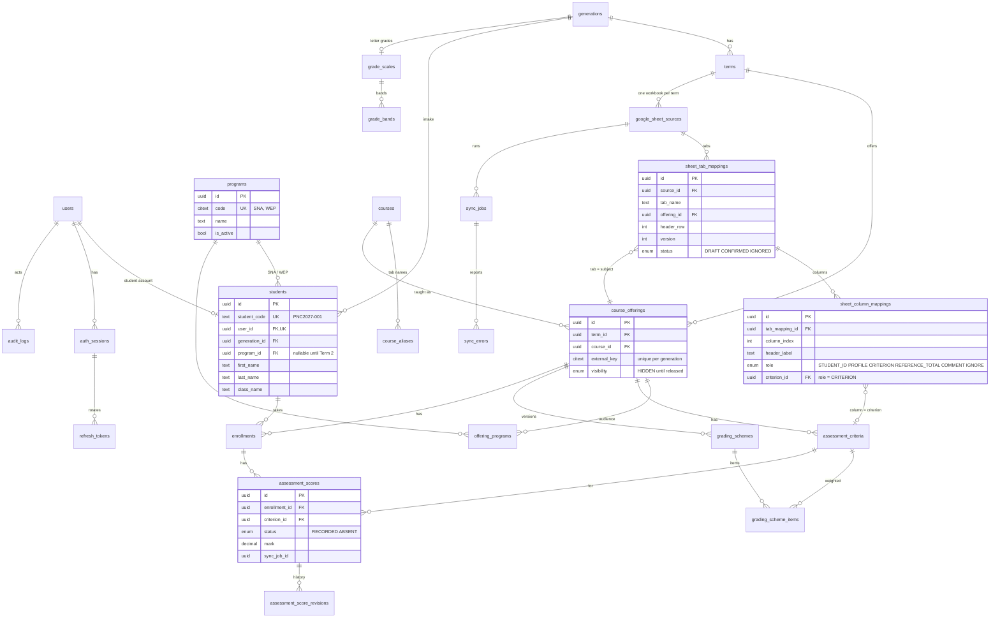
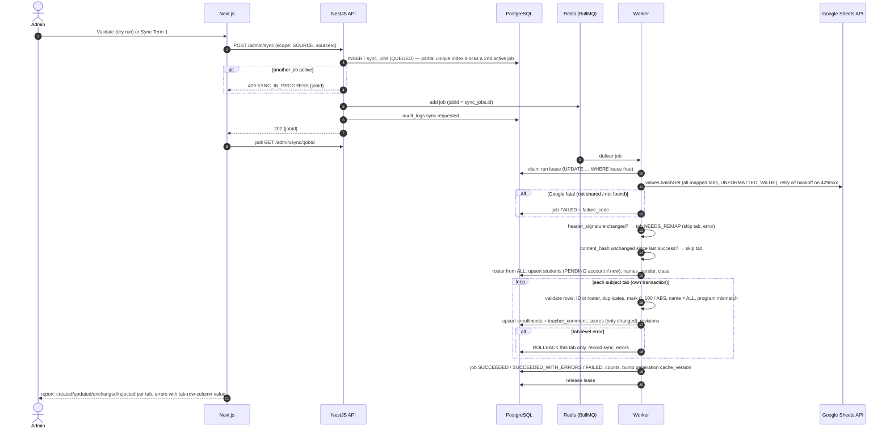

# Delivery Plan: Term Workbooks, Programs and Go-Live (1 January 2027)

_Written 2026-10-30. Builds on the existing code and docs (`architecture.md`, `database-design.md`,
`google-sheets-template.md`, `progress.md`)._

## 0. Executive summary

**Most of the system already exists.** Phases 0–9 in `progress.md` are done and tested: auth
(Argon2id, rotating refresh tokens, CSRF, lockout), RBAC with a route-policy test, audit log,
generations/terms/offerings, versioned grading schemes, an idempotent sync engine with score
revisions, a BullMQ worker, a results cache, and the admin and student UIs. 181 unit and 143
integration tests pass.

**The gap is the input format, not the platform.** The existing parser needs a "strict" workbook:
`_meta`, `Students`, `Courses` and `Criteria` tabs, plus a machine-key row 1 on every tab. The
school's real workbook (`TERM1- GEN 2027 Scoring.xlsx`) is different:

| Real workbook                                                                     | Existing parser expects                     |
| --------------------------------------------------------------------------------- | ------------------------------------------- |
| One workbook **per term**                                                         | One workbook per generation (intake)        |
| One tab per subject (`Logic`, `ENG`, `PL`, `BCU`, `MsOffice`)                     | Subjects listed in a `Courses` tab          |
| Human headers with the weight inside the label (`Quiz 1 10%`, `Speaking (10%)`)   | `Criteria` tab with `max_mark` and `weight` |
| Header row varies: row 1 (Logic) or row 3 under 2 group rows (ENG: `EXAMS (60%)`) | Row 1 machine keys, row 2 labels            |
| Computed `TOTAL` / `GRADE`, free-text `COMMENTS`                                  | Unknown column → whole course rejected      |
| No roster tab; every tab repeats ID, first name, last name, gender, class         | `Students` roster tab                       |
| No SNA/WEP program concept                                                        | No program concept                          |

**Strategy:** keep the engine, add a **"term workbook" adapter**:

1. Detect headers automatically.
2. Have the admin confirm a **tab → subject** and **column → criterion** mapping once per term.
3. Store that mapping.
4. Feed the existing apply/revision/cache pipeline.

Teachers keep their sheets as they are. Add **programs** (SNA/WEP) as data. This is about 6 weeks
of solo work, which leaves UAT and a buffer before 1 January.

**RabbitMQ: not needed.** Section C.4 explains why.

---

## 1. Decisions and assumptions

Decisions **D1–D13** were confirmed on 2026-10-30. **A1–A3** are working assumptions.

| #   | Decision                                                                                                                                                                                                                                               |
| --- | ------------------------------------------------------------------------------------------------------------------------------------------------------------------------------------------------------------------------------------------------------ |
| D1  | **Login ID = full student ID** exactly as in the sheet (`PNC2027-001`), case-insensitive. No short-ID alias.                                                                                                                                           |
| D2  | **Each teacher edits their own subject tab.** Headers can change mid-term, so header-change detection (`NEEDS_REMAP`) is a must-have.                                                                                                                  |
| D3  | **Blank cell = not entered yet** (subject shows INCOMPLETE), never zero. The BCU tab's own `Total` counts blanks as 0, so it will differ from the system total. Expected; explain it in UAT.                                                           |
| D4  | **Group weights are split equally** across their columns (ENG `Projects (15%)` → Role Play 7.5 + English for IT 7.5). The admin can override on the mapping screen; the cross-check against the sheet `TOTAL` flags a wrong split.                     |
| D5  | **Letter grades are in the MVP.** One editable grade scale per intake. Placeholder bands until the school confirms: A ≥ 85, B ≥ 70, C ≥ 50, F < 50. Students see letters only once the admin marks the scale **confirmed**.                            |
| D6  | **Teacher `COMMENTS` are shown to students**, on the subject detail page, once that subject is released.                                                                                                                                               |
| D7  | **Scores are hidden until an admin releases** the subject or term (existing `visibility`).                                                                                                                                                             |
| D8  | **Admins assign SNA/WEP in the app** (bulk by class or by selection). Sheets don't need a program column.                                                                                                                                              |
| D9  | **`ALL` is the master roster** (IDs, first/last name, gender, class). Subject tabs only add enrollments and scores; a name that differs from `ALL` is a warning. A student in a subject tab but missing from `ALL` → row rejected (`UNKNOWN_STUDENT`). |
| D10 | **5 terms per intake** (matches the current default; `term_count` stays configurable).                                                                                                                                                                 |
| D11 | **GEN2027 only** on 1 January. GEN2026 (no student IDs in its sheet) is post-launch.                                                                                                                                                                   |
| D12 | **Production on one cloud VPS** with Docker Compose + Caddy (already prepared in `docker-compose.prod.yml`).                                                                                                                                           |
| D13 | **All 5 admins have equal rights** (single ADMIN role, everything audited). **First passwords are printed on paper per class** from the existing CSV export.                                                                                           |

| #   | Assumption                                                                                                                                                                                                        |
| --- | ----------------------------------------------------------------------------------------------------------------------------------------------------------------------------------------------------------------- |
| A1  | "Intake year" = existing **Generation** (`GEN2027`). Terms belong to a generation.                                                                                                                                |
| A2  | One Google workbook = one term of one generation. `_meta` (`generation_code`, `education_term`) is optional. When present it is used as a safety check. When absent the admin picks generation + term on connect. |
| A3  | Each criterion column is a mark **out of 100**. The `%` in the header is its weight in the subject total; weights per subject total 100. `TOTAL` / `GRADE` are read only to **cross-check**, never as truth.      |

---

## A. Database design

### A.1 What stays, what changes

The existing schema (`packages/database/prisma/schema.prisma`) already models
generation → term → offering → criteria/scheme → enrollment → score, with sync history. Changes
are **additive**, in one migration:

| Change                                                                                                                           | Why                                                                                       |
| -------------------------------------------------------------------------------------------------------------------------------- | ----------------------------------------------------------------------------------------- |
| **New** `programs`                                                                                                               | SNA, WEP, and future programs as rows, not code                                           |
| **New** `offering_programs` (join)                                                                                               | Which programs a term-subject is for. No rows = shared (English, PL)                      |
| `students.program_id` (nullable FK), `first_name`, `last_name`                                                                   | Program from Term 2. The sheet splits names                                               |
| **New** `course_aliases`                                                                                                         | `ENG`, `ENGLISH`, `English` → one subject. A new tab name is mapped once, then remembered |
| `google_sheet_sources.term_id` (nullable FK), `layout` enum (`STRICT_V1` / `TERM_WORKBOOK`), `roster_tab`, `ignored_tabs text[]` | One workbook per term; `ALL` is the roster (D9). The old strict layout keeps working      |
| **New** `sheet_tab_mappings`                                                                                                     | Tab → offering, header row, ID column, mapping version                                    |
| **New** `sheet_column_mappings`                                                                                                  | Column → criterion / profile field / reference total / comment / ignore                   |
| `enrollments.teacher_comment` (text, nullable)                                                                                   | `COMMENTS` column, shown to students once the subject is released (D6)                    |
| **New** `grade_scales`, `grade_bands`                                                                                            | Letter grades per intake, editable, `confirmed` flag gates student display (D5)           |
| `enrollments.sheet_total` (decimal, nullable)                                                                                    | Sheet's own `TOTAL`, kept for the cross-check only                                        |
| `sync_jobs.content_hash` (char 64), `mapping_versions` (jsonb)                                                                   | Skip unchanged tabs; record which mapping a job used                                      |
| `generations.term_count` (smallint, default 5)                                                                                   | Terms are currently fixed at 5 on creation. Make it data                                  |

### A.2 ERD



### A.3 New and changed table definitions

Conventions as today: `uuid` v7 PKs, `timestamptz(3)` `created_at` and `updated_at`, `citext` for codes.

**`programs`**

| Column      | Type   | Constraints                 |
| ----------- | ------ | --------------------------- |
| `id`        | uuid   | PK                          |
| `code`      | citext | UNIQUE, `^[A-Z0-9_]{2,16}$` |
| `name`      | text   | NOT NULL                    |
| `is_active` | bool   | default true                |

**`offering_programs`** — PK `(offering_id, program_id)`; index `(program_id)`. No rows for an
offering = shared by all programs.

**`course_aliases`**

| Column      | Type   | Constraints                                |
| ----------- | ------ | ------------------------------------------ |
| `alias`     | citext | PK (normalized: trimmed, spaces collapsed) |
| `course_id` | uuid   | FK → courses, index                        |

**`students` (changed)** — add `program_id uuid NULL FK → programs`, `first_name text`,
`last_name text`. Keep `full_name` as a generated or maintained `first || ' ' || last` so search
and results stay unchanged. Index `(generation_id, program_id, class_name)`.

**`google_sheet_sources` (changed)**

| Column         | Type   | Notes                                                                  |
| -------------- | ------ | ---------------------------------------------------------------------- |
| `term_id`      | uuid   | NULL for `STRICT_V1`; NOT NULL for `TERM_WORKBOOK` (CHECK). FK → terms |
| `layout`       | enum   | `STRICT_V1` \| `TERM_WORKBOOK`                                         |
| `roster_tab`   | text   | default `ALL`. Read for student profiles only, never for scores        |
| `ignored_tabs` | text[] | default `{}`. Tabs starting with `_` are always ignored                |

Partial unique index: one ACTIVE `TERM_WORKBOOK` source per `term_id`.

**`grade_scales`** — `id` PK, `generation_id` UNIQUE FK → generations, `confirmed bool default
false`, `confirmed_by/at`. Seeded with the placeholder bands when an intake is created.

**`grade_bands`**

| Column      | Type         | Constraints                                               |
| ----------- | ------------ | --------------------------------------------------------- |
| `scale_id`  | uuid         | FK → grade_scales, ON DELETE CASCADE                      |
| `letter`    | text         | UNIQUE `(scale_id, letter)`, 1–3 chars                    |
| `min_total` | decimal(5,2) | UNIQUE `(scale_id, min_total)`, 0–100; one band must be 0 |
| `is_pass`   | bool         | the pass mark is the lowest passing band                  |

The letter is computed on read from the computed total, never stored per score. Changing a band
is audited and takes effect everywhere at once, because it bumps the generation's `cache_version`.

**`sheet_tab_mappings`**

| Column             | Type     | Constraints / notes                                                |
| ------------------ | -------- | ------------------------------------------------------------------ |
| `id`               | uuid     | PK                                                                 |
| `source_id`        | uuid     | FK → google_sheet_sources                                          |
| `tab_name`         | text     | UNIQUE `(source_id, tab_name)`                                     |
| `sheet_tab_id`     | int      | Google's numeric sheetId: survives tab renames                     |
| `offering_id`      | uuid     | FK → course_offerings, NULL when `IGNORED`. UNIQUE `(offering_id)` |
| `header_row`       | int      | 1-based leaf header row (detected, admin may override)             |
| `status`           | enum     | `DRAFT` \| `CONFIRMED` \| `IGNORED`                                |
| `version`          | int      | +1 on every confirmed change                                       |
| `header_signature` | char(64) | SHA-256 of normalized header cells: detects changed columns        |
| `confirmed_by/at`  | uuid/ts  | audit                                                              |

**`sheet_column_mappings`**

| Column           | Type | Constraints / notes                                                                                                        |
| ---------------- | ---- | -------------------------------------------------------------------------------------------------------------------------- |
| `id`             | uuid | PK                                                                                                                         |
| `tab_mapping_id` | uuid | FK, ON DELETE CASCADE                                                                                                      |
| `column_index`   | int  | 0-based. UNIQUE `(tab_mapping_id, column_index)`                                                                           |
| `header_label`   | text | leaf label as read (`Quiz 1 10%`)                                                                                          |
| `group_label`    | text | parent group (`MIDTERM (30%)`) when multi-row                                                                              |
| `role`           | enum | `STUDENT_ID`, `FIRST_NAME`, `LAST_NAME`, `GENDER`, `CLASS`, `PROGRAM`, `CRITERION`, `REFERENCE_TOTAL`, `COMMENT`, `IGNORE` |
| `criterion_id`   | uuid | FK → assessment_criteria. CHECK `role = 'CRITERION'` ⇔ NOT NULL. UNIQUE `(tab_mapping_id, criterion_id)`                   |

Criteria keep using the existing `assessment_criteria` + versioned `grading_schemes`. A confirmed
mapping **proposes** a scheme with the parsed weights. The existing DRAFT/PUBLISHED flow publishes it.
Changing weights later = new scheme version, so history is never lost.

### A.4 How the academic structure maps

| Concept                   | Table(s)                                           | Example                                               |
| ------------------------- | -------------------------------------------------- | ----------------------------------------------------- |
| Intake year               | `generations`                                      | `GEN2027`                                             |
| Term                      | `terms (generation_id, number)`                    | GEN2027 · Term 1                                      |
| Program                   | `programs`, `students.program_id`                  | SNA, WEP                                              |
| Subject (catalog)         | `courses` + `course_aliases`                       | `ENG` "English" ← aliases `ENG`, `ENGLISH`            |
| Term-subject offering     | `course_offerings (term_id, course_id)`            | GEN2027 T1 English; GEN2026 T1 English is another row |
| Program-specific offering | `offering_programs`                                | GEN2027 T2 "Network Admin" → SNA only                 |
| Shared offering           | no `offering_programs` rows                        | GEN2027 T2 English → all                              |
| Enrollment                | `enrollments (student_id, offering_id)`            | Created when the student's row appears in the tab     |
| Assessment item           | `assessment_criteria` + `grading_scheme_items`     | `Quiz 1`, max 100, weight 10                          |
| Score                     | `assessment_scores` + `assessment_score_revisions` | 90, RECORDED, with change history                     |

A new subject, program or term means inserting rows. No code changes.

### A.5 Sync history: re-sync without duplicates or loss

Most of this already exists and is tested (engine integration tests):

| Guarantee                     | Mechanism                                                                                                                        |
| ----------------------------- | -------------------------------------------------------------------------------------------------------------------------------- |
| No duplicate students         | `students.student_code` UNIQUE; upsert by normalized ID                                                                          |
| No duplicate enrollments      | UNIQUE `(student_id, offering_id)`                                                                                               |
| No duplicate scores           | UNIQUE `(enrollment_id, criterion_id)`; upsert                                                                                   |
| Re-run with same data = no-op | Value compared before write; revision rows only on change (tested "idempotent re-run (no writes)")                               |
| Nothing silently lost         | Blank cell where a value existed → value **kept** + warning; student removed from tab → `present_in_source=false`, never deleted |
| Full history                  | `assessment_score_revisions` (old/new, job, tab, row); `audit_logs` append-only (trigger)                                        |
| No concurrent runs            | Partial unique index `sync_jobs_one_active_per_source` + run lease                                                               |
| Partial failure isolation     | Per-course (per-tab) transaction: a bad tab rolls back alone, the job ends `SUCCEEDED_WITH_ERRORS`                               |
| Reproducible                  | **New:** `sync_jobs.mapping_versions` + `content_hash` per tab record exactly what was applied                                   |

---

## B. System flows

### B.1 Admin: connect a term workbook and map it (once per term)

```mermaid
flowchart TD
    A[Admin: Generation GEN2027 → Term 1 → Connect workbook URL] --> B{Service account can read?}
    B -- no --> B1[Show SHEET_NOT_SHARED + email to share with]
    B -- yes --> C{_meta present?}
    C -- yes --> C1{generation_code / education_term match?}
    C1 -- no --> C2[Reject: GENERATION_MISMATCH / TERM_MISMATCH]
    C1 -- yes --> D
    C -- no --> D[Read ALL as roster + every subject tab except _* and ignored_tabs]
    D --> D1{ALL tab present?}
    D1 -- no --> D2[Error ROSTER_TAB_MISSING: admin picks another roster tab]
    D1 -- yes --> E[Per tab: find header row = first row in top 10 containing 'STUDENT ID']
    E --> F[Resolve multi-row groups: label spans until next group label]
    F --> G[Classify columns: ID / profile by synonyms; TOTAL, GRADE → reference; COMMENT; rest = criterion candidates]
    G --> H[Parse weight from label: 'Quiz 1 10%', 'Speaking (10%)', 'Quiz 3- 10%']
    H --> H1[Group weight without per-column % → split equally, e.g. Projects 15% → 7.5 + 7.5]
    H1 --> I[Match tab name via course_aliases → subject, else 'new subject?']
    I --> J[Cross-check: recompute TOTAL from parsed weights on filled rows vs sheet TOTAL]
    J --> K[Mapping review screen per tab: subject, programs, criteria + weights, issues]
    K --> L{Admin confirms tab}
    L -- fix --> K
    L -- confirm --> M[Save tab + column mapping v1, create offering, criteria, scheme DRAFT → publish]
    M --> N[Ready to sync]
```

Cross-check examples from the real file: Logic row 1 →
`90·.10+89·.10+90·.10+97·.10+60·.25+78·.35 = 78.9`, which equals the sheet `Total` ✅. `MsOffice`
has no weights in its headers, so the admin enters them and the cross-check against `TOTAL` confirms
them. Mismatch > 0.5 on more than 5% of rows → `WEIGHTS_DISAGREE_WITH_SHEET_TOTAL` warning shown
before confirming.

### B.2 Admin: sync (every time, idempotent)



Error levels (existing scopes, extended):

| Scope | Examples                                                                                                    | Effect                         |
| ----- | ----------------------------------------------------------------------------------------------------------- | ------------------------------ |
| FILE  | not shared, `_meta` mismatch                                                                                | Nothing applied, job FAILED    |
| TAB   | **new:** `NEEDS_REMAP` (headers changed), no ID column, `UNMAPPED_TAB` (new tab appeared)                   | Tab skipped, others applied    |
| ROW   | bad/duplicate student ID, `UNKNOWN_STUDENT` (not in `ALL`)                                                  | Row skipped                    |
| CELL  | `abc`, `-5`, `120`, `8,5`                                                                                   | Cell skipped, rest of row kept |
| WARN  | name differs from `ALL` (BCU row 8 `SREYMOM MAO` vs `MAO SREYMOM`), `PROGRAM_MISMATCH`, blank-over-existing | Applied, flagged               |

### B.3 Student: login and view scores

```mermaid
sequenceDiagram
    autonumber
    actor S as Student
    participant Web as Next.js
    participant API as NestJS API
    participant R as Redis
    participant DB as PostgreSQL

    S->>Web: student ID PNC2027-001 + password
    Web->>API: POST /auth/login (Origin checked)
    API->>R: rate limit per IP + per identifier
    API->>DB: user by normalized username; Argon2id verify; lockout counters
    alt bad credentials
        API-->>Web: 401 INVALID_CREDENTIALS (same for unknown ID)
    end
    API->>DB: create auth_session + refresh token (hash only); audit auth.login.success
    API-->>Web: Set-Cookie access (15 min) + refresh (HttpOnly, Secure, SameSite)
    alt mustChangePassword
        Web->>S: forced change-password screen (all other routes 403 until done)
    end
    S->>Web: open Results
    Web->>API: GET /student/me/results?term=1
    Note over API: studentId taken from the session only.<br/>No ID parameter exists; ?studentId → 400
    API->>R: get results:{gen cache_version}:{studentId}
    alt cache miss
        API->>DB: enrollments of THIS student ∩ visibility = VISIBLE, scores, published schemes
        API->>R: set (version-keyed)
    end
    API-->>Web: terms → subjects → criteria, total, letter (if scale confirmed), teacher comment, status
```

### B.4 Admin: reset password and manage access

```mermaid
sequenceDiagram
    autonumber
    actor A as Admin
    participant API as NestJS API
    participant DB as PostgreSQL
    participant R as Redis

    A->>API: POST /admin/students/:id/reset-password (CSRF token)
    API->>API: RolesGuard ADMIN, throttle 20/min
    API->>API: generate temp password (CSPRNG)
    API->>DB: hash Argon2id, must_change_password = true, expires_at = now + 14d, status PENDING→ACTIVE
    API->>DB: revoke all sessions of the student
    API->>R: denylist revoked session ids (access tokens die ≤ 15 min, usually now)
    API->>DB: audit student.password.reset (actor, target, ip; never the password)
    API-->>A: 200 {temporaryPassword, expiresAt} Cache-Control: no-store (shown once)
    Note over A: Bulk: POST /admin/students/issue-credentials → CSV for a class.<br/>Disable: PATCH /admin/students/:id/status DISABLED → sessions revoked.
```

---

## C. Backend architecture

### C.1 Module structure (existing + new, marked ★)

```text
apps/api/src
├─ auth/            login, refresh, logout, change-password, guards (Auth, Roles, Csrf, MustChangePassword)
├─ audit/           append-only audit log + GET /admin/audit-logs
├─ generations/     intakes + terms                         (★ configurable term_count)
├─ programs/ ★      CRUD programs; bulk assign students to a program
├─ courses/         subject catalog                         (★ aliases)
├─ academic/        offerings, visibility/release           (★ offering_programs)
├─ criteria/, grading-schemes/   criteria + versioned weights
├─ grade-scales/ ★  letter bands per intake, confirm
├─ sheets-sources/  connect workbook, preview               (★ term_id, layout, ignored_tabs)
├─ sheet-mappings/ ★ detect → review → confirm tab/column mappings
├─ sync/            create/list/retry jobs (enqueue only)
├─ students/        list, status, reset password, bulk credentials (★ program filter)
├─ results/         /student/me* (session-scoped) + admin view
├─ dashboard/, health/, infra/ (Prisma, Redis), config/
packages/
├─ sheets/  ★ src/term-workbook/ header detection, weight parsing, group headers, column classifier
├─ sync/    ★ apply-term-workbook.ts → reuses apply-course/apply-roster logic
└─ shared/  grading engine (★ letter from bands), student-id normalization
apps/worker  BullMQ processor (unchanged except dispatch on source.layout)
```

### C.2 Main endpoints (new or changed; everything else exists, see `api-specification.md`)

| Method         | Path                                                | Purpose                                                                  |
| -------------- | --------------------------------------------------- | ------------------------------------------------------------------------ |
| GET/POST/PATCH | `/admin/programs`, `/admin/programs/:id`            | Manage SNA/WEP/…                                                         |
| POST           | `/admin/students/program`                           | `{ studentIds \| className, programId }` bulk assign (audited)           |
| POST           | `/admin/terms/:id/sources`                          | Connect a **term** workbook `{ url, label }`                             |
| POST           | `/admin/sources/:id/detect`                         | Read the workbook, return a proposed mapping per tab (writes DRAFT rows) |
| GET            | `/admin/sources/:id/mappings`                       | All tab mappings with status, issues, cross-check result                 |
| PUT            | `/admin/sources/:id/mappings/:tabMappingId`         | Edit: subject, programs, column roles, criterion names, weights          |
| POST           | `/admin/sources/:id/mappings/:tabMappingId/confirm` | Lock mapping → create offering/criteria/scheme, version + 1              |
| POST           | `/admin/sources/:id/mappings/:tabMappingId/ignore`  | Mark tab ignored                                                         |
| POST           | `/admin/sources/:id/preview`                        | (exists) dry-run sync using confirmed mappings                           |
| POST           | `/admin/sync`                                       | (exists) scope SOURCE / GENERATION                                       |
| POST           | `/admin/terms/:id/release`                          | ★ convenience: set all offerings of a term VISIBLE (audited)             |
| GET/PUT        | `/admin/generations/:id/grade-scale`                | Read / replace bands (validated: covers 0–100, no overlaps; audited)     |
| POST           | `/admin/generations/:id/grade-scale/confirm`        | Mark the scale official → letters become visible to students             |
| GET            | `/student/me/results`                               | (exists) + `letter` (when confirmed) + `teacherComment` per subject      |

### C.3 Google Sheets authentication

- **Service account**, scope `https://www.googleapis.com/auth/spreadsheets.readonly` only. Admins
  share each workbook with the service-account email as **Viewer**. No OAuth consent screen, no
  user tokens to refresh, and the app can never edit teacher sheets. This is already implemented
  in `packages/sheets/src/google-reader.ts`.
- Key file mounted as a Docker secret and readable by root only (`security.md` §5). Never commit
  it. A key appears to already exist on your machine outside the repo
  (`PNC-PROJECT/student-score-sync-….json`). Use it in Sprint 0 to clear the
  "live Google test" item in `progress.md` → Blocked.
- Read with `spreadsheets.get` (tab list + `sheetId`) then one `values.batchGet` per workbook with
  `valueRenderOption=UNFORMATTED_VALUE`, so you get numbers rather than formatted text. Merged
  group headers come back in the top-left cell only, and the "span until next label" rule handles
  that.
- Quota: 300 students × ~8 tabs is a few requests per sync, far below Google's per-minute limits.
  Retries with backoff already exist.

### C.4 Role of Redis and RabbitMQ

| Concern                                         | Tool               | Needed?                                                                                                                                                 |
| ----------------------------------------------- | ------------------ | ------------------------------------------------------------------------------------------------------------------------------------------------------- |
| Sync job queue (async, retries, crash recovery) | **Redis + BullMQ** | Yes. Already built and tested, including run lease and orphan sweep                                                                                     |
| Results cache (version-keyed)                   | Redis              | Nice, cheap. 300 students would be fine without it, but it exists and falls back to PostgreSQL                                                          |
| Rate limiting / login throttling                | Redis              | Yes. Shared counters across API instances                                                                                                               |
| Revoked-session denylist                        | Redis              | Yes. Makes logout and reset effective immediately instead of within 15 min                                                                              |
| Notifications ("scores released" email)         | BullMQ queue       | Post-launch. A second BullMQ queue, no new infrastructure                                                                                               |
| **RabbitMQ**                                    | —                  | **Not needed.** It would duplicate BullMQ, add a broker to run, monitor and back up alone, and buys nothing at 300 users and a handful of jobs per term |

**Recommendation:** drop RabbitMQ from the stack. If it's a hard requirement (for example a course
assessment rule), it's contained: `SyncQueueService` (producer) and `SyncProcessor` (consumer) are
the only two touch points. Swapping transport costs about 4–5 days plus re-testing the
lease/recovery behavior. Do that **after** 1 January, never before.

---

## D. Security

Status column: ✅ exists and tested · ★ to add.

| Area                             | Design                                                                                                                                                                                                                                          | Status       |
| -------------------------------- | ----------------------------------------------------------------------------------------------------------------------------------------------------------------------------------------------------------------------------------------------- | ------------ |
| Password hashing                 | Argon2id (m=19 MiB, t=2, p=1), PHC string; policy 10–128 chars, not containing the ID, not common, not repeated chars                                                                                                                           | ✅           |
| Session strategy                 | Short-lived JWT access token (15 min) in HttpOnly Secure cookie + opaque refresh token (SHA-256 stored), rotated on use; reuse revokes the whole session; absolute session lifetime                                                             | ✅           |
| CSRF / CORS                      | Origin/Referer check + per-session CSRF token on mutations; CORS allowlist                                                                                                                                                                      | ✅           |
| Brute force                      | Per-IP and per-identifier throttles in Redis; account lockout with `Retry-After`; generic error for unknown ID vs wrong password                                                                                                                | ✅           |
| Role-based access                | `@Roles()` + `RolesGuard`; `/admin/*` → ADMIN, `/student/*` → STUDENT; **route-policy test fails the build if any route lacks a policy**                                                                                                        | ✅           |
| Students see only their own data | Student endpoints have **no ID parameter**. Identity comes from the session (`/student/me*`); `?studentId` → 400; results query filters `student_id = session.studentId` AND visible; cache key includes studentId; tests for cross-student 404 | ✅           |
| ★ keep it that way               | Integration tests proving student A never gets B's comment, letter or program, and that hidden subjects expose no comment; keep admin results uncached                                                                                          | ★            |
| First-login password change      | New accounts PENDING (locked hash) until credentials issued; temp password expires in 14 days; `MustChangePasswordGuard` blocks everything except change-password                                                                               | ✅           |
| Admin reset                      | Temp password shown once (`no-store`), sessions revoked, audited without secret                                                                                                                                                                 | ✅           |
| Audit logs                       | Append-only table (UPDATE/DELETE blocked by trigger); actor, action, entity, ip, user agent, request id                                                                                                                                         | ✅           |
| ★ new audited actions            | `mapping.confirmed`, `mapping.ignored`, `program.created/updated`, `student.program.assigned`, `term.released`, `offering.visibility.changed`, `grade_scale.updated/confirmed`                                                                  | ★            |
| Transport & headers              | Caddy HTTPS, HSTS, nonce CSP, no secrets in logs (scrubbed), Sentry with data collection off                                                                                                                                                    | ✅           |
| Google key                       | Docker secret, read-only scope, Viewer share                                                                                                                                                                                                    | ✅           |
| Credential delivery              | CSV per class over HTTPS, formula-injection safe; tell admins to print and hand out, then delete the file                                                                                                                                       | ✅ / process |
| Backups                          | Nightly `pg_dump` (`docker/backup/backup.sh`) + **restore drill before go-live** (`scripts/restore-drill.sh`)                                                                                                                                   | ★ run it     |

---

## E. Agile timeline (30 Oct 2026 → 1 Jan 2027)

About 40 working days, solo. Sprint length 2 weeks. Planned load is about 80% so that holidays
(Independence Day 9 Nov, Water Festival in November) and sick days fit.

### E.1 Sprints

| Sprint                         | Dates                                      | Goal                             | Tasks (estimate in days)                                                                                                                                                                                                                                                                                                                                                                                                                                                          | Milestone / exit criteria                                                                                                   |
| ------------------------------ | ------------------------------------------ | -------------------------------- | --------------------------------------------------------------------------------------------------------------------------------------------------------------------------------------------------------------------------------------------------------------------------------------------------------------------------------------------------------------------------------------------------------------------------------------------------------------------------------- | --------------------------------------------------------------------------------------------------------------------------- |
| **0 Setup & decisions**        | Fri 30 Oct – Sun 1 Nov                     | Unblock everything               | Decisions D1–D13 recorded ✅; send the school the 4 remaining items in F.2 (0.25); live Google test with the service-account key on a **copy** of the GEN2027 T1 workbook (0.5); anonymized fixture from real headers (0.5); confirm RabbitMQ decision (0.1)                                                                                                                                                                                                                      | Live read of the real workbook works; remaining items sent                                                                  |
| **1 Model + parser**           | Mon 2 – Fri 13 Nov                         | Read the real workbook correctly | Migration: programs, offering_programs, aliases, source term/layout/roster_tab, tab/column mappings, student names, teacher_comment, grade scales, term_count (2); `term-workbook` parser: `ALL` roster, header detection, group headers + equal split, weight regex, column classifier, cross-check (4); unit tests on fixtures incl. `f` header, swapped names, blanks, BCU partial, MsOffice no weights (2); detect endpoint (1)                                               | **M1:** `POST /detect` on the real file proposes correct criteria + weights for all 5 tabs; cross-check passes on Logic, PL |
| **2 Mapping + sync**           | Mon 16 – Fri 27 Nov                        | Real data in the database        | Mapping review/confirm API (2) + admin UI screen (3); engine adapter `apply-term-workbook` (roster from `ALL`, enrollments, comments, scores, revisions) reusing existing apply code (2.5); `NEEDS_REMAP` / `content_hash` / `UNMAPPED_TAB` (1); integration tests: first import, idempotent re-run, changed mark, blank-over-value, removed student, renamed header (1.5)                                                                                                        | **M2:** GEN2027 Term 1 fully synced on dev; re-sync = 0 writes; report readable                                             |
| **3 Programs, UI, ship-ready** | Mon 30 Nov – Fri 11 Dec                    | Feature-complete + deployable    | Programs CRUD + bulk assign + filters (1.5); offering audience in UI, program shown in student profile (1); term release button (0.5); teacher comment on subject detail (0.5); grade scale API + admin editor + letter on student pages (1.5); Phase 10: prod compose on VPS staging, Caddy HTTPS, CI green, backups (2.5); Playwright e2e: admin connect→map→sync→release, student login→forced change→view (2); update docs (`google-sheets-template.md` §term workbook) (0.5) | **M3 (Fri 11 Dec): feature freeze.** Staging URL live with real T1 data                                                     |
| **4 UAT & go-live**            | Mon 14 – Wed 23 Dec                        | School accepts it                | UAT session 1 with 1–2 admins (Mon 14): connect, map, sync, release (0.5); compare 20 random students × all subjects against the sheet `TOTAL` (1); fix UAT bugs (3); security pass: route-policy, cross-student tests, dependency audit, headers (1); restore drill (0.5); prod deploy + create 5 admin accounts (0.5); UAT session 2 / sign-off (Fri 18) (0.5)                                                                                                                  | **M4 (Mon 21 Dec): go/no-go.** **M5 (Wed 23 Dec): production live**, admins trained                                         |
| **Buffer**                     | Thu 24 – Thu 31 Dec                        | Absorb slippage                  | Only bug fixes. Prepare credential CSVs per class; a 1-page student guide (login, change password)                                                                                                                                                                                                                                                                                                                                                                                | Code frozen 28 Dec                                                                                                          |
| **Launch**                     | Fri 1 Jan 2027 (hand-out first school day) | Students log in                  | Issue credentials per class; monitor login errors and Sentry for the first week                                                                                                                                                                                                                                                                                                                                                                                                   |                                                                                                                             |

Moving letter grades into the MVP (D5) adds 1.5 days to Sprint 3, which is now fully loaded
(10 of 10 days). If it slips, the Playwright suite moves to the first two days of Sprint 4; the
feature freeze on 11 Dec does not move.

### E.2 Scope

**MVP (must have on 1 Jan)**

- Connect one workbook per term, auto-detect headers, admin confirms the mapping, sync, re-sync safely.
- Validation report with tab/row/column/value; dry-run preview; per-tab isolation.
- Subjects, aliases and programs as data; shared vs program-specific offerings.
- Weights from headers, cross-checked against sheet `TOTAL`; versioned scheme publish.
- Release (visibility) per subject/term.
- Letter grades from an editable per-intake scale, shown once the scale is confirmed (D5).
- Teacher comments on the released subject's detail page (D6).
- Student login with full student ID, forced first password change, view own scores by term.
- Admin: student list (filter class/program), reset password, bulk credential CSV, disable account, audit log.
- Production deployment with HTTPS, backups and a tested restore.

**Nice to have (post-launch)**

- GPA / weighted term average across subjects (needs credit rules from the school).
- Email or Telegram "scores released" notifications (second BullMQ queue).
- Scheduled automatic re-sync (BullMQ repeatable job), Drive change detection.
- Import historical GEN 2026 (needs student IDs added to that workbook first).
- PDF transcript per student; admin analytics (class averages, at-risk list).
- RabbitMQ, only if required by someone outside the project.

### E.3 Testing strategy

| Level       | What                                                                                                                           |
| ----------- | ------------------------------------------------------------------------------------------------------------------------------ |
| Unit        | Parser: header row detection, group spans, every weight label variant seen in the real file, column classification, cell rules |
| Integration | Engine on a real PostgreSQL: idempotency, revisions, remap detection, partial failure, program mismatch                        |
| Security    | Route policy, cross-student access, CSRF, throttles (existing suites + new endpoints)                                          |
| E2E         | Playwright: the two critical journeys above, run in CI against the compose stack                                               |
| Data UAT    | **System total vs sheet TOTAL** for every student × subject. Every mismatch explained (weights, blanks-as-zero) before release |

---

## F. Risks and open questions

### F.1 Top risks

| #   | Risk                                                                                                                                       | Likelihood / impact | Mitigation                                                                                                                                                                                                                                                                        |
| --- | ------------------------------------------------------------------------------------------------------------------------------------------ | ------------------- | --------------------------------------------------------------------------------------------------------------------------------------------------------------------------------------------------------------------------------------------------------------------------------- |
| R1  | **Messy headers**: typos (`f` instead of FIRST NAME), trailing spaces (`Gymglish `), weights in different formats, multi-row group headers | High / High         | Detect + **human-confirmed mapping** stored per tab; header signature → `NEEDS_REMAP` instead of guessing; fixtures from the real file                                                                                                                                            |
| R2  | Teachers edit columns mid-term (add `Quiz 4`, rename)                                                                                      | High / Medium       | Confirmed: teachers edit their own tabs (D2). Ask teachers to **protect the header rows** (Google Sheets → Protect range, editors = admins). Signature change blocks only that tab with a clear error; admin re-confirms in 2 minutes; scheme gets a new version, old scores kept |
| R3  | Blank vs zero (BCU `Total` counts blanks as 0)                                                                                             | High / Medium       | Decided: blank = not entered (D3). Show INCOMPLETE, not a wrong total. Tell teachers the BCU sheet total will differ, and use `ABS` for a real zero                                                                                                                               |
| R4  | Name inconsistencies across tabs (`SREYMOM MAO` vs `MAO SREYMOM`)                                                                          | Medium / Low        | Student ID is the only key; names come from `ALL` (D9); mismatches = warning list for the school to clean                                                                                                                                                                         |
| R4b | Placeholder grade bands shown as if official                                                                                               | Medium / High       | Letters hidden from students until an admin confirms the scale (D5); the release checklist includes "grade scale confirmed"                                                                                                                                                       |
| R5  | Weights not shown in header (MsOffice) or don't total 100                                                                                  | Medium / High       | Admin enters weights; `TOTAL` cross-check proves them; publish blocked unless 100                                                                                                                                                                                                 |
| R6  | Wrong workbook connected to wrong term                                                                                                     | Low / High          | `_meta` check when present; term shown on every screen; preview before sync; scores hidden until release                                                                                                                                                                          |
| R7  | Solo developer, 2 months, holidays                                                                                                         | Medium / High       | Reuse the existing engine (about 70% done); strict MVP; feature freeze 11 Dec; 8-day buffer                                                                                                                                                                                       |
| R8  | Students' first login on day one overloads support                                                                                         | Medium / Medium     | Credentials per class on paper, 1-page guide, admins can reset in seconds; staged hand-out per class                                                                                                                                                                              |
| R9  | Program assignment unknown at Term 2 start                                                                                                 | Medium / Medium     | Enrollment comes from tab rows, so sync works without programs; program only adds filters and warnings                                                                                                                                                                            |
| R10 | Service-account key leaked                                                                                                                 | Low / High          | Read-only scope, Viewer share only, Docker secret, rotate on suspicion                                                                                                                                                                                                            |

### F.2 Still open (needed before the stated date)

The 14 original questions are answered: see D1–D13 in Section 1. These four details remain:

| #   | Item                                                                                                | Needed by                     | Fallback if not answered                                                         |
| --- | --------------------------------------------------------------------------------------------------- | ----------------------------- | -------------------------------------------------------------------------------- |
| O1  | The school's **real grade bands and pass mark**                                                     | UAT, Mon 14 Dec               | Launch with letters hidden (scale unconfirmed); totals still shown               |
| O2  | **Domain name and VPS account** (who pays, who holds the login)                                     | Sprint 3 staging, Mon 30 Nov  | Staging on a temporary subdomain; production waits                               |
| O3  | Are any subjects taken by **only some students** (retakes, electives)?                              | Sprint 2, Mon 16 Nov          | Enrollment already comes from which tabs list a student, so it likely just works |
| O4  | Will teachers **protect the header rows** and keep `ALL` up to date when a student joins or leaves? | Before Term 1 sync on staging | `NEEDS_REMAP` and `UNKNOWN_STUDENT` errors catch it; the admin fixes it per sync |

### F.3 Next three actions

1. Send O1–O4 to the school.
2. Run the live Google read against a **copy** of `TERM1- GEN 2027 Scoring.xlsx` uploaded to Google Sheets.
3. Start Sprint 1 with the migration (A.3) and the term-workbook parser (`ALL` roster + header
   detection), using fixtures copied from the real header rows.
